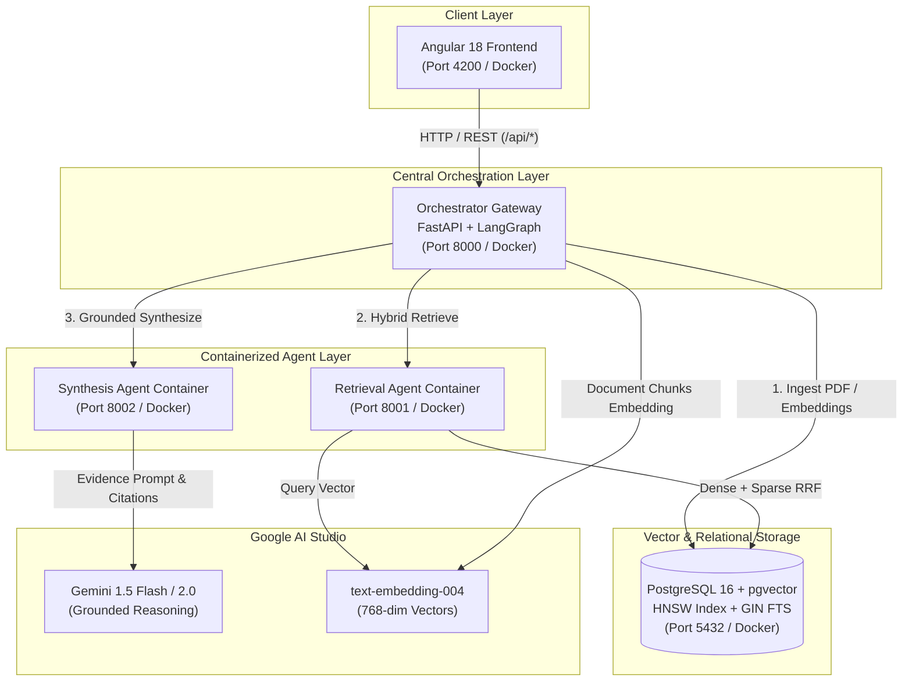

# Multi-Agent RAG System with LangGraph, Google AI Studio, pgvector & Angular

An end-to-end, enterprise-grade **Retrieval-Augmented Generation (RAG)** system featuring a **multi-container microservice architecture**, where every agent runs in an isolated Docker container coordinated through a central **LangGraph Orchestrator**. The system ingests PDF and text documents, computes embeddings using **Google AI Studio (`text-embedding-004`)**, stores them in **PostgreSQL with `pgvector`**, and performs **Hybrid Search (Dense Cosine Similarity + Sparse Full-Text Search with Reciprocal Rank Fusion / RRF)** returning verifiable citations.

All Python services use **Astral's `uv`** for ultra-fast dependency management, and the frontend is built with **Angular (v18)** and containerized with multi-stage Nginx.

---

## 🏛️ System Architecture



---

## 🚀 Key Features

1. **Strict Multi-Container Isolation**:
   - **Postgres (pgvector)**: Vector database with HNSW indexing and GIN full-text search.
   - **Retrieval Agent**: Dedicated microservice for embedding calculation and hybrid search fusion.
   - **Synthesis Agent**: Dedicated microservice for grounded answer reasoning and citation verification via Gemini.
   - **Orchestrator Gateway**: Central router coordinating requests, state propagation, and document ingestion via **LangGraph**.
   - **Angular Frontend**: Modern reactive SPA with microservices health monitoring, document manager, and evidence drawer.

2. **Ultra-Fast Python Packaging with Astral `uv`**:
   - Each Python service uses `uv` with `pyproject.toml` configuration for fast, deterministic builds inside Docker.

3. **Hybrid Search with Reciprocal Rank Fusion (RRF)**:
   - Combines semantic **Dense Vector Search** ($\cos$ distance on `vector(768)`) with lexical **Sparse Full-Text Search** (`to_tsvector` and `ts_rank_cd`).
   - Merges candidate lists using Reciprocal Rank Fusion:
     $$RRF(d) = \frac{w_{\text{dense}}}{k + \text{rank}_{\text{dense}}(d)} + \frac{w_{\text{sparse}}}{k + \text{rank}_{\text{sparse}}(d)}$$
     *(where $k=60$ by default, with configurable weights).*

4. **Grounded Citations & Evidence Viewer**:
   - Citations format `[^n]` directly linked to original source documents, page numbers, chunk identifiers, and similarity metrics.
   - Clickable citation badges in the Angular UI open the exact excerpt in the Evidence drawer.

5. **Stateful Multi-Agent Orchestration with LangGraph**:
   - Built with LangGraph `StateGraph`, providing a transparent execution trace:
     `Query Analysis` $\to$ `Retrieval Agent` $\to$ `Context Evaluation` $\to$ `Synthesis Agent` $\to$ `Citation Verification`.

---

## 📂 Repository Structure

```
.
├── docker-compose.yml              # Complete 5-container service definition
├── .env.example                    # Environment template
├── .env                            # Active environment variables
├── README.md                       # System documentation
├── scripts/
│   ├── init-db.sql                 # pgvector extension, schema, and indexes
│   └── setup.sh                    # Helper setup verification script
├── services/
│   ├── orchestrator/               # Central Gateway & LangGraph pipeline (Port 8000)
│   │   ├── Dockerfile              # Docker build using Astral uv
│   │   ├── pyproject.toml          # uv package configuration
│   │   └── src/
│   │       ├── main.py             # FastAPI entrypoint
│   │       ├── config.py           # Environment settings
│   │       ├── db.py               # Database connection pool
│   │       ├── graph.py            # LangGraph StateGraph workflow
│   │       ├── state.py            # LangGraph state schema
│   │       ├── document_processor.py # PDF/TXT parsing & chunking
│   │       ├── clients/            # HTTP clients for agent containers
│   │       └── routes/             # API routes (/api/chat, /api/documents, /api/system)
│   ├── retrieval-agent/            # Hybrid Search Agent container (Port 8001)
│   │   ├── Dockerfile              # Docker build using Astral uv
│   │   ├── pyproject.toml          # uv package configuration
│   │   └── src/
│   │       ├── main.py             # FastAPI entrypoint
│   │       ├── config.py           # Settings
│   │       ├── db.py               # Asyncpg database pool
│   │       ├── embeddings.py       # Google AI Studio text-embedding-004
│   │       └── hybrid_search.py    # Dense + Sparse RRF algorithm
│   └── synthesis-agent/            # Grounded Synthesis Agent container (Port 8002)
│       ├── Dockerfile              # Docker build using Astral uv
│       ├── pyproject.toml          # uv package configuration
│       └── src/
│           ├── main.py             # FastAPI entrypoint
│           ├── config.py           # Settings
│           ├── llm.py              # Google AI Studio Gemini LLM client
│           └── synthesizer.py      # Grounded prompting & citation extraction
└── frontend/                       # Angular 18 Web UI (Port 4200 / 80)
    ├── Dockerfile                  # Multi-stage build (Node -> Nginx)
    ├── nginx.conf                  # Static file server & API reverse proxy
    ├── package.json                # Angular 18 dependencies
    ├── angular.json                # Build configuration
    ├── tsconfig.json               # TypeScript config
    └── src/
        ├── index.html
        ├── styles.css              # Modern dark theme styles
        └── app/
            ├── app.component.ts    # Main view with Chat, Documents, Tuning
            ├── models/rag.models.ts
            ├── services/rag.service.ts
            └── components/
                ├── header/         # Live microservice health pills
                ├── document-upload/# Drag & drop, list, and sample button
                ├── citations-panel/# Evidence excerpt & score viewer
                └── workflow-trace/ # LangGraph pipeline visualizer
```

---

## ⚡ Quickstart Guide

### 1. Configure Environment Variables
Copy `.env.example` to `.env` (if not already done) and insert your **Google AI Studio API Key**:
```bash
cp .env.example .env
```
Edit `.env`:
```env
GOOGLE_API_KEY=your_gemini_api_key_here
```
*(You can obtain a free Gemini API key at [aistudio.google.com](https://aistudio.google.com/)).*

### 2. Build and Launch Containers
Run Docker Compose to build and start all 5 containers:
```bash
docker compose up --build
```

### 3. Access the System
| Service | URL | Description |
| :--- | :--- | :--- |
| **Angular Frontend** | [http://localhost:4200](http://localhost:4200) | Full Web Application UI |
| **Orchestrator Docs** | [http://localhost:8000/docs](http://localhost:8000/docs) | Swagger OpenAPI UI |
| **Retrieval Agent Docs** | [http://localhost:8001/docs](http://localhost:8001/docs) | Retrieval Microservice API |
| **Synthesis Agent Docs** | [http://localhost:8002/docs](http://localhost:8002/docs) | Synthesis Microservice API |
| **PostgreSQL pgvector** | `localhost:5432` | Vector DB (`raguser` / `ragpassword`) |

---

## 🧪 Testing the RAG Pipeline

1. **Open the Web UI** at `http://localhost:4200`.
2. Check the **Microservices Status** bar at the top:
   - Green pills indicate active connectivity for `Orchestrator`, `pgvector`, `Retrieval Agent`, and `Synthesis Agent`.
3. In the left panel, click **"Load Sample Book"** to seed a knowledge document with chapters on Knowledge Graphs and Hybrid Search, or drag and drop any **PDF or Text file**.
4. In the chat box, ask a question (e.g., *"How does Hybrid Search and RRF work?"*).
5. Watch the **LangGraph Orchestration Pipeline** execute in real-time in the right panel:
   - Node 1: Query Intent Formulation
   - Node 2: Retrieval Agent (Dense + Sparse RRF)
   - Node 3: Context Relevance Verification
   - Node 4: Synthesis Agent (Google AI Studio Gemini reasoning)
   - Node 5: Citation Target Verification
6. Click any citation badge (e.g. `[^1]`) in the synthesized response to view the exact **document page, excerpt, and hybrid score breakdown** in the Evidence Drawer!

---

## 📡 API Reference

### Orchestrator Endpoints (Port 8000)
- `POST /api/chat`: Submit question through the LangGraph multi-agent pipeline.
  ```json
  {
    "query": "What is Reciprocal Rank Fusion?",
    "top_k": 5,
    "dense_weight": 0.6,
    "sparse_weight": 0.4
  }
  ```
- `POST /api/documents/upload`: Multipart file upload for PDF, TXT, or MD documents.
- `GET /api/documents`: List all ingested documents and their chunk counts.
- `DELETE /api/documents/{id}`: Delete document and its vector chunks.
- `POST /api/documents/sample`: Seed sample knowledge document.
- `GET /api/system/status`: Comprehensive health check of all microservices.

### Retrieval Agent Endpoints (Port 8001)
- `POST /retrieve`:
  ```json
  {
    "query": "vector cosine distance",
    "top_k": 5,
    "dense_weight": 0.6,
    "sparse_weight": 0.4
  }
  ```

### Synthesis Agent Endpoints (Port 8002)
- `POST /synthesize`:
  ```json
  {
    "query": "Explain how hybrid search works",
    "chunks": [...]
  }
  ```

---

## 🛡️ Hybrid Search Tuning

The UI provides dynamic weight tuning for your retrieval strategy:
- **Semantic Mode ($w_{\text{dense}}=0.8, w_{\text{sparse}}=0.2$)**: Prioritizes conceptual and semantic meaning using Google AI Studio vector embeddings.
- **Hybrid Mode ($w_{\text{dense}}=0.6, w_{\text{sparse}}=0.4$)**: Balanced fusion combining semantic vectors with lexical keyword precision.
- **Exact FTS Mode ($w_{\text{dense}}=0.2, w_{\text{sparse}}=0.8$)**: Prioritizes exact keyword and phrase matches via PostgreSQL Full-Text Search.
